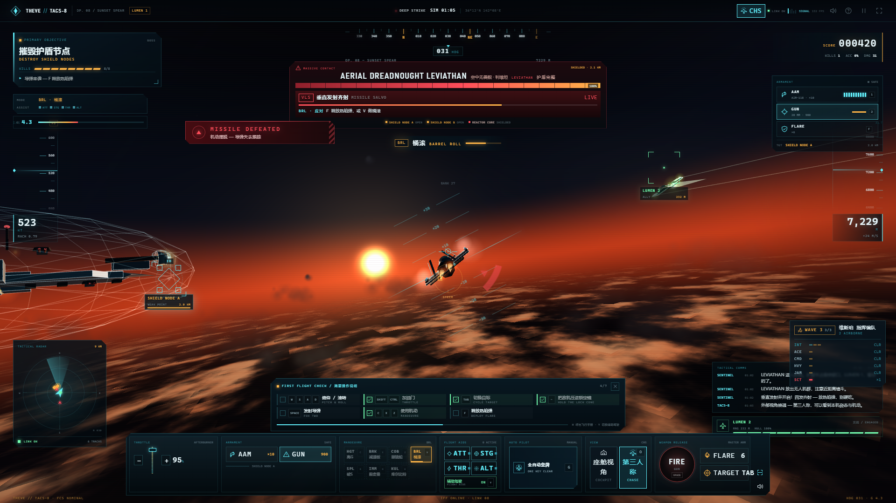
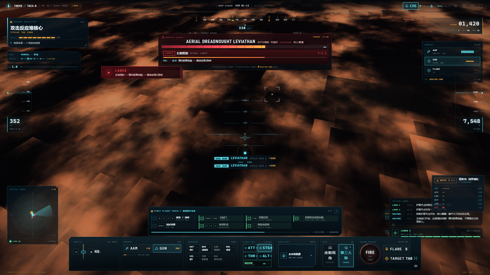
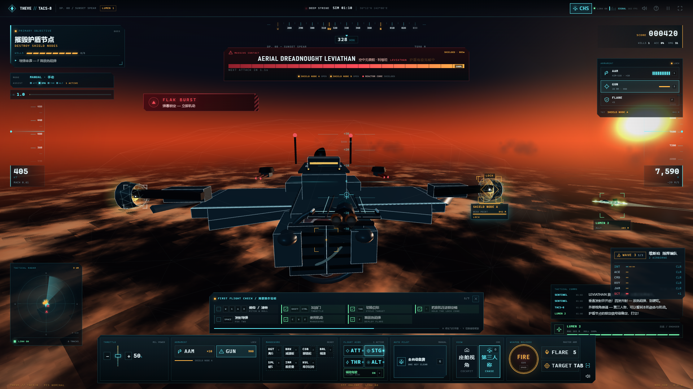
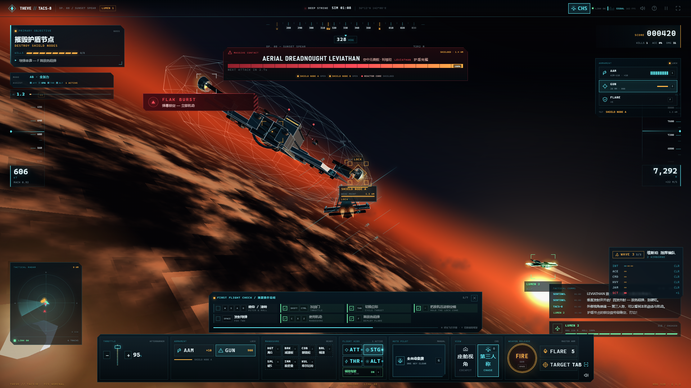
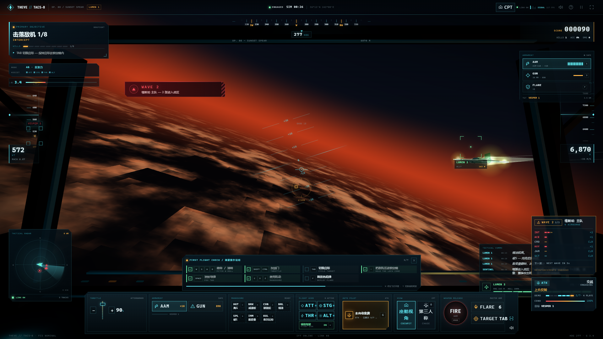
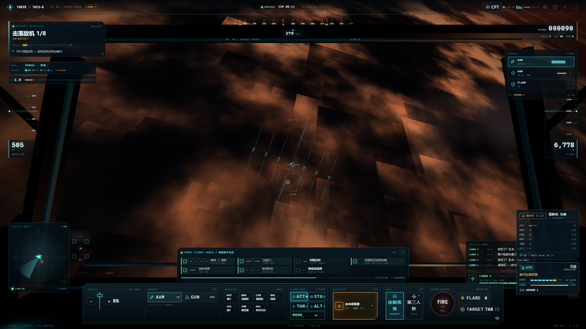
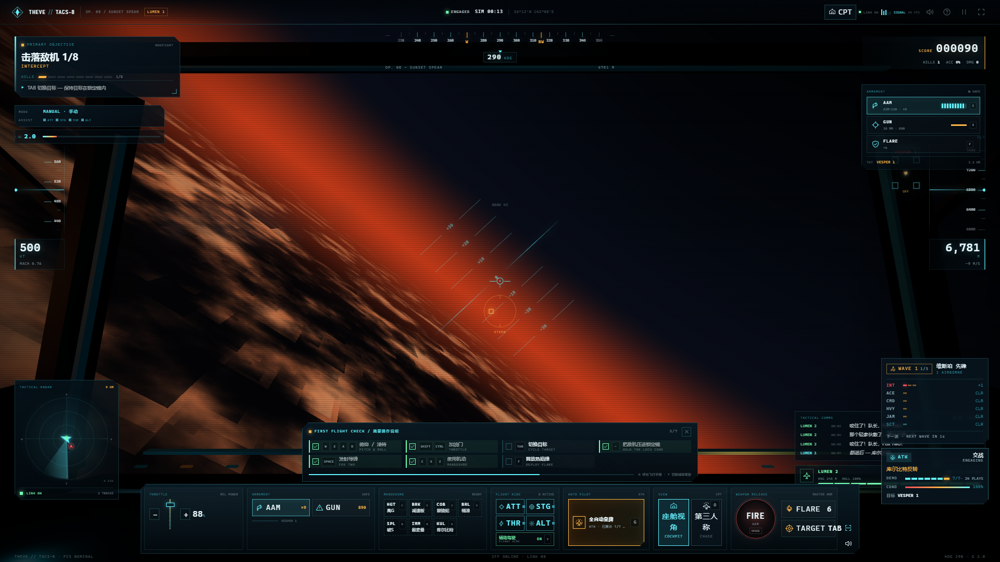
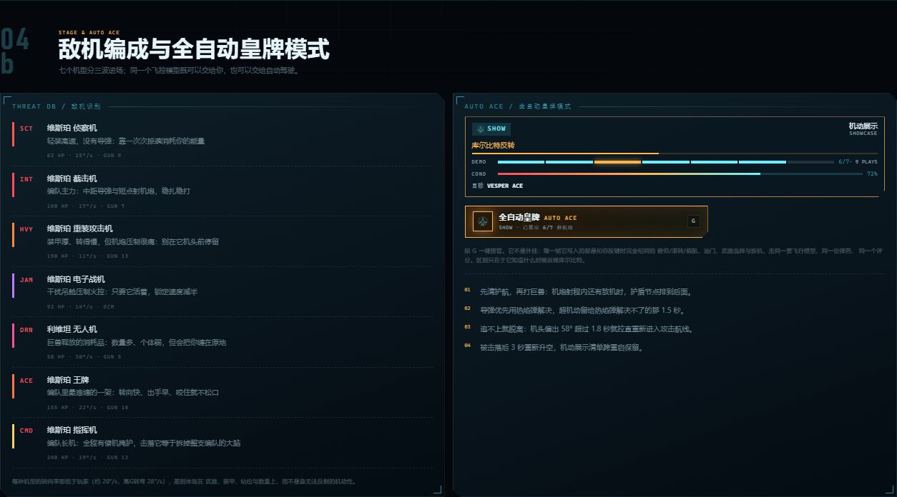

# THEVE // TACS-8

> 座舱航电设计系统 × 可玩空战 Showcase  
> An original cockpit avionics UI kit and playable air-combat showcase inspired by
> **ACE COMBAT 8: WINGS OF THEVE**.


THEVE // TACS-8 把电影化空战的第一人称座舱拆解成一套 React + TypeScript 组件库：
近黑金属、切角与磷光刻度构成的 HUD，three.js 绘制的黄昏平流层与战争巨兽，
以及全部由 WebAudio 实时合成的配乐、音效与打击反馈。Showcase 里你可以真正坐进 LUMEN 1 的座舱，
迎击分三波进场的 VESPER 编队，穿过弹幕，把 LEVIATHAN 的护盾节点逐个摘下来。

不想自己飞的时候，按 **`G`** 开启 **全自动皇牌模式（AUTO ACE）**：飞控接管，
自己升空、自己选目标、在最合适的时机做眼镜蛇、库尔比特与殷麦曼，把整场任务打完。

v0.5 把它变成三个问题的合集：LEVIATHAN 现在有**实体碰撞体积**、四种必须用机动回答的攻击
（近防炮 / 垂发齐射 / 护盾脉冲 / 主炮照射）；热焰弹重做成四发带惯性的燃烧弹体，
任何从 130 m 内掠过的导弹都会被引开；按 **`O`** 可以切到**第三人称跟随视角**，
看到自己那架 F-08 在做什么机动。

所有美术、机体、巨兽、文案与声音都是原创 / 程序化生成；本项目不使用任何官方素材。

---

## 快速开始

```bash
pnpm install
pnpm dev          # http://127.0.0.1:5173
```

生产构建与预览：

```bash
pnpm build        # 先构建 @theve/ui，再构建 @theve/showcase
pnpm preview      # http://127.0.0.1:4173
```

校验与测试：

```bash
pnpm typecheck
pnpm test
pnpm verify:ui    # Playwright 冒烟 + docs/screenshots；需先运行 dev 或 preview
# 针对 preview 验证：PREVIEW_URL=http://127.0.0.1:4173/ pnpm verify:ui
```

环境：Node 22+、pnpm 11+、Chrome / Edge（WebGL2 + WebAudio）。首次构建需要联网安装依赖；
运行时不请求远程字体、图片或音频。

---

## 体验流程

1. **ATTRACT / 开场** — 落日云海、巨兽剪影、任务简报卡与电影化标题。
2. **BRIEFING / 任务简报** — 目标、载具、威胁档案与操作速查；右侧有「全自动皇牌模式」按钮。
3. **BOOT / 航电自检** — 2.8 秒冷启动序列，可跳过。
4. **FIRST FLIGHT CHECK / 简要操作说明** — 进入任务后左下角出现的 7 项检查单，会随着你真的做出动作逐条打勾并自动收起。
5. **DOGFIGHT / 制空 · 三波** — 先锋（截击机 + 侦察机）→ 主队（重装机 + 王牌）→ 指挥编队（指挥机 + 电子战机）。
   每波进场都会补给弹药，AWACS 会同时报出机型编成与应对重点。
6. **LEVIATHAN / 战争巨兽** — 清空编队后触发。摧毁两具舷外挂架上的护盾节点，再突入舰艏的反应堆口。
   它是一道**问答题**：近防炮、垂发齐射、护盾脉冲、主炮照射各有唯一答案（见下）。
   舰体是实心的——撞上去掉 45% 结构；炮弹打在装甲上只会溅出冷色火花。
7. **DEBRIEF / 结算** — 评分 S / A / B / C、命中率、战损、任务时间与最佳评级（localStorage）。

任务失败后可直接重试；暂停菜单提供画质、反转俯仰、**视角**、辅助驾驶逐项开关、音量与静音设置。

---

## LEVIATHAN 攻击机制（v0.5）

| 代码 | 攻击 | 电报窗口 | 你必须做什么 |
| --- | --- | --- | --- |
| `CIWS` | 近防炮拦截 | 0.7 s | 不要正对舰体直线进入 — 侧向掠袭（炮口只覆盖前半球） |
| `VLS` | 垂直发射齐射 | 1.5 s | `F` 热焰弹，或 `V` 桶滚 — 四发雷达制导 |
| `PULSE` | 护盾冲击脉冲 | 2.4 s | 在 1.15 km 内盘旋超过 2.4 秒就会被锁定 — 脱离或加速穿出 |
| `LANCE` | 主炮照射 | 3.0 s | 炮口亮起后横向脱离炮轴 — 桶滚或高G急转（核心暴露后解锁） |

每一次攻击都会在 HUD 右侧的巨兽面板上打出**名称、倒计时进度条和应对提示**，
同时在电台里由 AWACS 或僚机报出；舰体的动画也和攻击一一对应
（垂发井发光、主炮口充血、反应堆装甲花瓣张开、近防炮跟着你转）。
**输给巨兽永远是输了一个决定，而不是被偷袭。**

| 结果 | 触发条件 | 表现 |
| --- | --- | --- |
| 撞舰 | 飞进舰体 | 结构 −45%、被沿最近面推出、`HULL STRIKE · 部位` 告警 |
| 打装甲 | 炮弹扫掠命中舰体 | 冷色火花 + `ARMOUR · 部位`，不计数、不穿透 |
| 打节点 | 命中护盾节点 / 暴露的核心 | 正常伤害（v0.5 起按目标半径结算命中体积） |

---

## 第三人称跟随视角（v0.5）

按 **`O`**（或屏幕控制台的 VIEW 模块、任务栏右上角的 `CPT/CHS` 按钮）在座舱与外部视角之间切换，
设置持久化到 localStorage。外部视角渲染 LUMEN 1 本机：鸭翼、外倾双垂尾、
**跟着操纵杆动的副翼 / 襟翼 / 平尾**、随油门与加力变化的双发尾焰、航行灯，以及座舱里的飞行员。

相机是「吊杆 + 瞄准」：吊杆跟随航向与**被夹紧的俯仰**，再回头看飞机——
所以做眼镜蛇或库尔比特时镜头会留在原地看飞机竖起来，而不是跟着钻进机身。
姿态用阻尼跟随，猛机动时飞机会领先镜头一拍；机动期间吊杆额外后拉，
高 G / 失速 / 脚本机动会拉出**翼尖水汽**。视角只是视图，不是物理模式：
两种视角下的飞行状态逐位相同（有测试盯着）。

---

## 全自动皇牌模式（v0.4 · v0.5 扩充）

按 **`G`**（或简报页 / 控制台的按钮）一键开启。它**不是外挂**：
每一帧它写入的都是和你按键时完全相同的俯仰 / 滚转 / 偏航、油门、武器选择与扳机，
走同一套飞行模型、同一份弹药、同一个评分与同一个结算。

它做了三件事：

| 层 | 行为 |
| --- | --- |
| 飞行 | 坡度转弯 + 比例控制；轨道限循环检测（机头偏出 58° 超过 1.8 秒就拉直重新进入攻击航线）；最低攻击距离 |
| 战术 | 优先清护航再打巨兽；先打干扰机；导弹来了先放热焰弹，超机动只留给热焰弹解决不了的那 1.5 秒；被击落 3 秒后重新升空 |
| 演出 | 七种战斗机机动各绑定一个可读的战术情境，另外维护一份「展示清单」：天空安静时它会主动补上你还没看过的动作，并在电台里报出招式名 |

| 情境 | 机动 |
| --- | --- |
| 导弹咬尾、热焰弹打光或只剩 1.5 秒 | 眼镜蛇 / 库尔比特 / 桶滚 |
| 敌机贴到 720 m 内且已过肩 | 库尔比特（极限半径掉头） |
| 敌机在后方且高于你，速度还够 | 殷麦曼翻转 |
| 敌机俯冲脱离，你还有高度 | 破S机动 |
| 敌机从后方高速接近 | 减速板诱敌冲前 |
| 需要收紧盘旋 | 高G转弯（持续型，不脱离瞄准回路） |
| 天空安静且有高度余量 | 展示清单里下一个没做过的动作 |
| **巨兽主炮充能且你正在炮轴上（v0.5）** | **横向脱离炮轴 — 只在真的挡住时才中断攻击航路** |
| **巨兽护盾脉冲充能且你在 1.15 km 内（v0.5）** | **沿视线方向加速脱离** |

HUD 右侧会出现 **AUTO ACE 状态条**：当前模式、正在做的动作、`DEMO n/7` 展示进度、
机体状态与当前目标。电台里它有自己的声音（斜体青色），会说出「看好了 — 眼镜蛇机动」。

被击落不会结束：3.2 秒后它自己重新升空，**展示清单跨重启保留**，所以一键开启后一定会通关。

---

## 操作

| 输入 | 动作 |
| --- | --- |
| `W` / `S` | 俯仰（默认 S 拉杆抬头，可在暂停菜单反转） |
| `A` / `D` | 滚转 |
| `Q` / `E` | 偏航 |
| `Shift` / `Ctrl` | 加 / 减油门；滚轮也可调整 |
| `Space` | 发射当前武器（AAM 需锁定） |
| `J` | 机炮（按住连射） |
| `Tab` / `T` | 切换目标 |
| `F` | 热焰弹 |
| `1` / `2` | 选择 AAM / GUN |
| `Y` | 辅助驾驶总开关 |
| `O` | **切换视角（座舱 / 第三人称跟随，v0.5）** |
| `G` | **全自动皇牌模式总开关（一键自动通关）** |
| `M` | 静音 |
| `P` / `Esc` | 暂停 |
| `H` | 飞行手册 |
| 鼠标拖拽 | 虚拟驾驶杆 |
| 屏幕控制台 | 完整触屏可玩：油门、武器、机动、辅助、VIEW、FIRE、FLARE、TARGET、AUTO ACE |

### 敌机编成（v0.4）

三波进场，共 8 架编队机，加上巨兽释放的无人机。每种机型有独立的轮廓、涂装色、
血量、转向率、机炮与导弹配置：

| 代号 | 型号 | HP | 转向 | 武装 | 战术要点 |
| --- | --- | --- | --- | --- | --- |
| `SCT` | 维斯珀 侦察机 | 62 | 25°/s | 机炮 9 | 最快，无导弹；逼你跟着它掉能量 |
| `INT` | 维斯珀 截击机 | 100 | 17°/s | AAM + 机炮 7 | 编队主力，稳扎稳打 |
| `HVY` | 维斯珀 重装攻击机 | 190 | 11°/s | AAM + 机炮 13 | 转得最慢，但机炮最痛 |
| `JAM` | 维斯珀 电子战机 | 92 | 14°/s | 无 | **活着就一直压制火控：锁定速度减半** |
| `ACE` | 维斯珀 王牌 | 155 | 22°/s | AAM 冷却最短 + 机炮 10 | 出手早、咬住就不松口 |
| `CMD` | 维斯珀 指挥机 | 240 | 19°/s | AAM + 机炮 13 | 编队长机，得分最高 |
| `DRN` | 利维坦 无人机 | 58 | 30°/s | AAM + 机炮 5 | 巨兽放出，护盾一掉就停止 |

**平衡基线：** 玩家的坡度转弯上限约 20°/s（高G转弯 28°/s），所以**每一种敌机都比你转得慢**——
差距体现在武器、装甲、站位与数量上，而不是靠无法反制的机动性。v0.3 的敌机转向 47–66°/s，
在三机编队时读作「灵活」，在八机三波时只会读作「不可能」。

### 战斗机机动（v0.2）

| 输入 | 机动 | 说明 |
| --- | --- | --- |
| `C`（按住） | 高G转弯 HIGH-G TURN | 操纵面权限 ×1.55，转弯更紧，掉速与过载都更高（上限 9.8G） |
| `X`（按住） | 减速板 AIRBRAKE | 约 130 m/s² 的额外阻力，用于逼敌机冲前或收半径 |
| `Z` | 眼镜蛇机动 PUGACHEV COBRA | 1.7 秒内上仰到 ~112°；速度矢量几乎不变，咬尾者会直接冲前 |
| `V` | 桶滚 BARREL ROLL | 完整 360° 螺旋滚转，航向基本不变，55% 概率甩掉来袭导弹 |
| `B` | 破S机动 SPLIT-S | 半滚倒转后下扣半筋斗：掉头 180° 并把高度换成速度 |
| `N` | 殷麦曼翻转 IMMELMANN | 半筋斗上升后半滚改平：掉头 180° 同时抢回高度 |
| `K` | 库尔比特 KULBIT | 2.6 秒内以极小半径完成 360° 筋斗，代价是几乎全部动能 |

按住类机动跟随操纵杆即时生效；一次性机动由飞控按预设剖面接管姿态，动作结束的瞬间把操纵权交回，并自动把姿态归一化回正常包线（俯仰 ±77°）。

### 辅助驾驶（v0.2，默认开启）
| 代号 | 名称 | 行为 |
| --- | --- | --- |
| `ATT` | 姿态辅助 | 松杆时消除滚转漂移；接近平飞时把机翼摆正。压着坡度时不会跟你抢杆 |
| `STG` | 目标引导 | 目标在机头前方 ±74° 内时轻微带杆（偏航 ≤0.34、俯仰 ≤0.26），把敌机送进 12° 锁定锥 |
| `THR` | 自动油门 | 松手 1.6 秒后自动补油门保持交战速度；**只会加不会减**，绝不违背你的油门指令 |
| `ALT` | 低空保护 | 1300 m 提醒、820 m 告警、520 m 以下柔和拉起 |

设计约束：辅助只在你**没有操作的那根轴**上出力（自由度按输入幅度线性衰减），任何直接输入都会瞬间夺回控制权；按 `Y` 可以整组开关，暂停菜单可以逐项开关，设置持久化到 localStorage。

竖屏手机显示横屏提示；横屏手机使用精简 HUD 与控制台。全屏按钮位于右上角。

---

## 视觉与声音

**关键词：** 黄昏平流层 / 近黑金属 / 磷光青 / 琥珀锁定 / 红色告警 / 战术文档。

| Token | 值 | 用途 |
| --- | --- | --- |
| `--tv-void` | `#04070C` | 座舱底 |
| `--tv-deep` | `#07131D` | 面板底 |
| `--tv-cyan` | `#63F3FF` | 主 HUD / 可操作 |
| `--tv-ice` | `#E8F8FC` | 主数据 |
| `--tv-amber` | `#FFB547` | 锁定 / 照射 / 注意 |
| `--tv-red` | `#FF4D5A` | 敌机 / 告警 |
| `--tv-green` | `#74FFB0` | 僚机 / 友军 |
| `--tv-sun` | `#FF7A3D` | 落日 / 地平线 |

字体使用系统栈：Bahnschrift / DIN 类窄体用于标题，Cascadia Mono / JetBrains Mono 类等宽用于数据，
中文使用 Noto Sans / 微软雅黑回退。没有字体下载，没有 CDN 依赖。

**three.js 座舱：** 固定在相机上的座舱框与切角玻璃、程序化天空 shader、FBM 云海、
近场云团、低多边形敌机 / 僚机、可旋转雷达的空中无畏舰、对象池化爆炸与曳光弹。
v0.3 起战场本身也在演戏：远景弹幕与曳光弹持续扫过地平线，受创机拖着烟迹，
爆炸会用一盏池化点光源真的照亮云层。3D 在独立 rAF 中运行，不经过 React；
模拟以 60Hz 推进，只以 30Hz 向 React 发布快照。

**LEVIATHAN 模型（v0.5）：** 从「一摞盒子」重建为按模拟锚点摆放的完整舰体——
龙骨、飞行甲板、后掠翼、外挂架上的护盾节点舱、可开合的舰艏装甲花瓣、四座跟随玩家的近防炮、
会亮的垂发井、舰艏下方的主炮身管、包住全舰的护盾气泡。
**看到的就是打得到的**：复合碰撞体（`sim/boss.ts`）与模型共用同一组锚点。

**第三人称相机（v0.5）：** 「吊杆 + 瞄准」——吊杆跟随航向与被夹紧的俯仰，再回头看飞机，
姿态用阻尼跟随，机动期间额外后拉并拉出翼尖水汽。自机 F-08 有可动操纵面、双发尾焰与座舱飞行员。

**飞行模型（v0.2 手感重做）：** 操纵面权限随动压（速度）缩放，滚转用角加速度 + 阻尼产生机翼惯量，
俯仰走一阶滞后指令，转弯由坡度升力自动协调并叠加滚转协调舵；爬升掉速、俯冲增速，
拉杆与滚转产生诱导阻力，过载由俯仰角速度与速度实时积分。失速地板 150 m/s，
高速上限 330 m/s（加力 0.88 油门以上）。

**打击感（v0.3）：** 命中会有四道冰白刻线在准星上炸开并附上伤害数字，击坠时整圈点亮；
机炮每发都有炮口闪光与金属火花，护盾节点会把炮弹弹开成冷色涟漪；
挨打时 HUD 外圈出现指向来袭方向的扇区，镜头按方位被顶一下。
所有反馈都是 `age` 的纯函数——暂停时它们就停在原地，掉帧也不会和那一枪错位。

**WebAudio：** 全部程序化，没有音频文件。v0.3 把配乐换成一台真正的编曲机：
D 小调、六个段落（翱翔 / 制空 / 强攻 / 巨兽 / 凯旋 / 挽歌）、十条写好的旋律、
太鼓与弦乐固定音型、程序化生成的厅堂混响，只在小节线上换段。
音效层同样重做：机炮分瞬态 / 音体 / 机械三层，命中是金属短鸣，
爆炸按距离延迟并按真实声速衰减高频，导弹掠过时播放多普勒呼啸。

v0.5 的热焰弹是四层：发射器低频闷响（机身总线）、三发金属爆响（左右肩交替声场）、
**带通从 4200 Hz 扫到 560 Hz 的燃烧嘶声**（1.2–1.8 s，比爆响长 1.4 s），
以及一条轻得多普勒尾音。巨兽的四种攻击也各有自己的电报音：
主炮是升调电容啸叫，脉冲是加速的时钟，齐射是液压声加舱盖闷响，近防炮是电机启动的断续敲击；
主炮开火会压低整条音乐总线 2.4 秒。

首次 `LAUNCH` 用户手势才创建 AudioContext；静音、画质、俯仰与**视角**设置会持久化。

更多设计决策与迭代记录见 [`docs/DESIGN.md`](docs/DESIGN.md)。

---

## 轻量组件库

`@theve/ui` 的运行时 peer 依赖只有 React / ReactDOM / three；没有状态库、动画库或图标库。

| 入口 | 内容 | 是否依赖 three |
| --- | --- | --- |
| `@theve/ui` | tokens、primitives、HUD、飞行模拟、音频、Provider/hooks | 否 |
| `@theve/ui/three` | `CockpitViewport`、`CockpitScene`、目标投影 | 是 |
| `@theve/ui/styles.css` | 全部设计令牌与组件样式 | — |

### 最小用法

```tsx
import {
  CockpitProvider,
  CockpitHud,
  CockpitControls,
  useCockpitControls,
} from '@theve/ui';
import { CockpitViewport } from '@theve/ui/three';
import '@theve/ui/styles.css';

function CockpitExperience() {
  useCockpitControls({ onPause: () => {}, onHelp: () => {} });
  return (
    <CockpitProvider audio>
      <CockpitViewport />
      <CockpitHud />
      <CockpitControls />
    </CockpitProvider>
  );
}
```

`CockpitProvider` 可传入自定义 `scenario`（`sunsetSpearScenario` / `createDemoScenario`）。
HUD 组件均可单独复用；组合版 `CockpitHud` 只是本项目 Showcase 的默认布局。

### 组件概览（36+）

- **基础**：`TheveRoot` `Panel` `Button` `IconButton` `Tag` `Readout` `Meter` `Keycap` `Toggle` `StatusLamp` `Divider` `HazardStripe`
- **HUD**：`CockpitHud` `HeadingTape` `PitchLadder` `FlightPathMarker` `SpeedTape` `AltitudeTape` `TargetMarker` `LockReticle` `MissileWarning` `RadarScope` `WeaponRack` `CommsFeed` `WingmanStatus` `BossBar` `ObjectiveTracker` `ScoreTicker` `DamageOverlay`
- **操纵与辅助（v0.2）**：`ManeuverRail` `ManeuverBanner` `AssistRail` `FlightAidStrip` `LockSteeringCue` `StartupChecklist` `GLoadMeter`
- **打击反馈（v0.3）**：`HitConfirm` `DamageDirection` `KillTicker` `CombatFeedbackLayer`
- **关卡敌人与自动驾驶（v0.4）**：`AutoPilotButton` `AutoPilotRail` `WaveTracker`（另有 `AutoPilotButtonView` / `AutoPilotRailView` 两个纯展示版本，供文档页复用）
- **Boss 战（v0.5）**：`BossBar` 现在带攻击电报面板（名称 / 倒计时进度条 / 应对提示 / 严重度配色）
- **操作**：`CockpitControls`，内部组合油门、武器、机动、辅助、AUTO ACE、**VIEW**、FIRE、热焰弹与目标切换
- **模拟**：`CockpitEngine`、`MANEUVERS`、`ASSISTS`、`TUTORIAL_STEPS`、`useCockpit`、`useCockpitActions`、`useCockpitEngine`、`useCockpitSettings`、`useAudio`、`useCockpitControls`
- **敌机编成（v0.4）**：`ENEMIES` `ENEMY_ORDER` `enemyProfile` `resolveEnemyId` `waveReady` `describeWave` `waveBriefing` `enemyPriority`
- **自动驾驶（v0.4）**：`solveAutoPilot` `createAutoPilotMemory` `AUTO_MODE_LABEL` `SHOWCASE_PLAYS` `SHOWCASE_ORDER` `autoPilotCondition`
- **巨兽与视角（v0.5）**：`BOSS_HULL` `BOSS_ANCHOR` `BOSS_ATTACKS` `BOSS_ATTACK_ORDER` `BOSS_TURRETS` `BOSS_VLS` `BOSS_STAGE_LABEL` `bossAttack` `bossAttackPool` `bossHitTest` `bossSegmentHit` `bossHullPushOut` `toBossLocal` `fromBossLocal` `lanceHits` `lanceOffset` `lanceRadius`；`VIEW_ORDER` `VIEW_LABEL` `isViewMode` `IconView`
- **配乐（v0.3）**：`SCORE_SECTIONS` `SECTION_ORDER` `PHRASES` `selectSection` `phraseForBar` `chordForBar` `degreeToMidi` `midiToFreq`
- **3D**：`CockpitViewport`、`CockpitScene`（`getDebugInfo()` 供自动化测试）
- **音频**：`AudioEngine`（可在 Provider 外独立使用）

### 构建产物（以当前 lockfile 为准）

| 产物 | raw | gzip |
| --- | --- | --- |
| 核心入口 `dist/index.js` | 78.1 KB | 18.1 KB |
| three 入口 `dist/three.js` | 64.5 KB | 17.2 KB |
| 模拟/音频/three 共享块 | 197.9 KB | 54.7 KB |
| 样式 `dist/theve.css` | 84.4 KB | 16.9 KB |

Showcase 首屏在构建时做了路由级 code split；cockpit 路由的 three 包单独加载，
配乐数据表单独成块（`score-*.js`），不进首屏。

---

## 可访问性

- 所有控制按钮可键盘到达，2px 青色 focus ring；暂停 / 帮助 / 结算对话框带焦点陷阱。
- 仪表使用 `role="meter"` 与 `aria-valuetext`；告警使用限流的 `role="alert"`；通讯使用 `aria-live="polite"`。
- 敌我、锁定与告警不只依赖颜色：同时使用形状、图标、文字与方向箭头。
- 七种机动、四项辅助与检查单均为真实 `<button>`，带中文 `aria-label` 与键盘 `aria-pressed` 状态。
- 打击反馈同样不只靠颜色：受击扇区带箭头、命中刻线带伤害数字、击坠记录带文字标签。
  机炮一秒能命中十几次，所以命中标记**不**朗读，只有击坠用 `role="log"` 播报。
- 支持 `prefers-reduced-motion`：关闭镜头抖动、镜头冲击、扫描线、机动横幅与检查单的切入动画，
  命中标记也退化为不缩放的静态刻线，巨兽的攻击电报横幅也停止闪烁。
- 静音后，导弹告警、通讯与任务结果都有视觉替代。
- 视角切换是真实 `<button>`（控制台 VIEW 模块、任务栏 CHS 徽标、暂停菜单分段控件），
  带 `aria-pressed` 与中文 `aria-label`；巨兽电报面板用 `role="status"` 播报。
- 竖屏提示可继续进入精简模式；横屏手机有专门的短屏 HUD 布局。

---

## 版本

| 版本 | 主题 | 内容 |
| --- | --- | --- |
| 0.1 | 座舱与世界观 | 设计令牌、HUD 组件、three.js 座舱、程序化音频、SUNSET SPEAR 任务 |
| 0.2 | 战机操作 | 七种战斗机机动、四项辅助驾驶、进入任务后的简要操作说明、飞行手感重做 |
| 0.3 | 音效与打击感 | 编曲式生成配乐（六段落 / 十条旋律）、战斗音效分层重做、命中与受击反馈、战场氛围层 |
| 0.4 | 关卡敌人与全自动通关 | 七种敌机型号与三波编成、敌机机炮与电子干扰、一键全自动皇牌模式（AUTO ACE）与机动展示清单 |
| **0.5** | **Boss 战、热焰弹与第三人称视角** | **LEVIATHAN 重建（复合碰撞体积 + 四种需要机动应对的攻击 + 可动舰体）、四层热焰弹音效与燃烧弹体、按 `O` 切换的第三人称跟随视角与自机模型** |

---

## 目录

```
├─ apps/showcase/          # Vite + React Showcase（开场 / 座舱 / 图鉴）
├─ packages/theve-ui/      # 组件库、模拟、three 层、音频
├─ docs/
│  ├─ DESIGN.md            # 设计说明 / 令牌 / 场景与声音
│  └─ screenshots/         # Playwright 输出的验收截图
├─ scripts/verify-ui.mjs   # 冒烟测试 + 截图
└─ pnpm-workspace.yaml
```

**技术栈：** React 19.3 · TypeScript 5.9 · Vite 8.3 · three r186 · Vitest 5 · Playwright (system Chrome)。

---

## 验收截图

| | |
| --- | --- |
|  |  |
| v0.5 第三人称视角：桶滚中的 F-08、翼尖水汽与巨兽在侧 | v0.5 巨兽主炮电报：名称、倒计时、应对提示与舰体充能 |
|  |  |
| v0.5 LEVIATHAN：护盾气泡、闭合的反应堆装甲口与外挂节点 | v0.5 热焰弹：四发带惯性的燃烧弹体从尾后抛出 |
|  |  |
| v0.4 波次：`WAVE 2 / 3` 编成表、进场闪示与电台通报 | v0.4 AUTO ACE：右侧状态条、展示进度与当前目标 |
|  |  |
| v0.4 机动展示：殷麦曼翻转与展示清单计数 | v0.4 图鉴：七种机型的威胁档案与 AUTO ACE 卡片 |
|  |  |
| v0.3 命中确认：准星上的刻线、伤害数字与连击计数 | v0.3 击坠：爆炸、碎片与 SPLASH 记录 |
|  |  |
| LEVIATHAN 与护盾节点（座舱视角） | 任务结算 / S 评级 |

完整截图集（开场、任务简报与攻击手册、启动、制空、波次进场、命中确认、击坠、受击方位、
高G转弯、眼镜蛇、第三人称巡航与机动、热焰弹、巨兽护盾与主炮、暂停、手册、Boss 登场、
任务失败、全自动接管、机动展示、系统图鉴、敌机编成图鉴、1366 / 390 / 横屏）
在 [`docs/screenshots/`](docs/screenshots/)。

---

## 边界与非目标

- 这是设计实验与可玩 Showcase，不是《皇牌空战》的复刻；没有官方机体、Logo、音乐或美术。
- 飞行模型是街机化手感，不是真实气动；没有地形碰撞、多人联机或完整战役。
- 巨兽有碰撞体积，地形没有：撞进舰体会掉 45% 结构并被推出，撞进地面只会触发低空保护。
- 机动的姿态剖面是手工调参的脚本，不是真实飞控律；眼镜蛇 / 库尔比特只保留「姿态先动、速度矢量后动」这一条关键特征。
- 辅助驾驶不会在你正在操作的轴上出力，因此不会替你完成机动，也不会自动开火。
- 第三人称视角是跟随吊杆，不是自由镜头：不能离开飞机，也不能环绕观察。
- **AUTO ACE 是「一个会飞的玩家」，不是无敌模式**：它没有传送、没有免伤、没有额外的弹药或分数，
  被击落一样会跳伞。它的优势来自帧级精确的跟踪与不会慌的决策；它的上限仍然是你那架飞机的上限。
- 桌面 Chromium 为主要目标；Safari / Firefox 尽力兼容。WebGL 不可用时会退化为 CSS 黄昏 + 2D HUD。
- 音频必须在用户手势后启动；自动化无手势环境可能保持静默，但界面仍可用。
- 没有手柄支持；触屏与键鼠已覆盖全部核心操作。
- `window.__THEVE__` 是 Showcase 的调试桥（截图与冒烟测试使用），不是面向生产应用的接口。

## 原创说明

本项目以《皇牌空战8：希孚之翼》（ACE COMBAT 8: WINGS OF THEVE）的电影化空战气质为灵感，
世界观、呼号、机体、巨兽与全部视觉/声音资产均为原创。参考其公开的巨兽兵器、连锁破坏、
第一人称座舱方向：

- [ACE COMBAT 8: WINGS OF THEVE – Game Overview](https://www.bandainamcoent.com/news/ace-combat-8-wings-of-theve-game-overview)
- [PlayStation Blog – Annihilation Battle mode / story trailer](https://blog.playstation.com/2026/09/14/ace-combat-8-wings-of-theve-annihilation-battle-mode-confirmed-story-trailer-revealed/)
- [GameSpark – 巨大兵器与连锁破坏](https://www.gamespark.jp/article/2026/06/04/167407.html)

Licensed under the MIT License. See [`LICENSE`](LICENSE).
