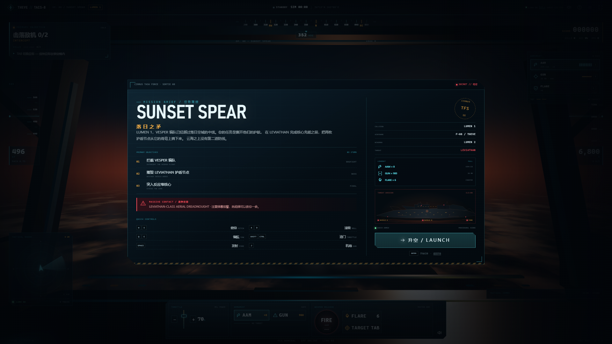

# THEVE // TACS-8

> 座舱航电设计系统 × 可玩空战 Showcase  
> An original cockpit avionics UI kit and playable air-combat showcase inspired by
> **ACE COMBAT 8: WINGS OF THEVE**.


THEVE // TACS-8 把电影化空战的第一人称座舱拆解成一套 React + TypeScript 组件库：
近黑金属、切角与磷光刻度构成的 HUD，three.js 绘制的黄昏平流层与战争巨兽，
以及全部由 WebAudio 实时合成的主题音效。Showcase 里你可以真正坐进 LUMEN 1 的座舱，
锁定 VESPER 编队，穿过弹幕，把 LEVIATHAN 的护盾节点逐个摘下来。

所有美术、机体、巨兽、文案与声音都是原创 / 程序化生成；本项目不使用任何官方素材。

---

## 快速开始

```bash
pnpm install
pnpm dev          # http://127.0.0.1:5173
```

生产构建与预览：

```bash
pnpm build        # 先构建 @theve/ui，再构建 @theve/showcase
pnpm preview      # http://127.0.0.1:4173
```

校验与测试：

```bash
pnpm typecheck
pnpm test
pnpm verify:ui    # Playwright 冒烟 + docs/screenshots；需先运行 dev 或 preview
# 针对 preview 验证：PREVIEW_URL=http://127.0.0.1:4173/ pnpm verify:ui
```

环境：Node 22+、pnpm 11+、Chrome / Edge（WebGL2 + WebAudio）。首次构建需要联网安装依赖；
运行时不请求远程字体、图片或音频。

---

## 体验流程

1. **ATTRACT / 开场** — 落日云海、巨兽剪影、任务简报卡与电影化标题。
2. **BRIEFING / 任务简报** — 目标、载具、威胁档案与操作速查。
3. **BOOT / 航电自检** — 2.8 秒冷启动序列，可跳过。
4. **DOGFIGHT / 制空** — 迎击 VESPER 编队；锁定、发射、热焰弹规避。
5. **LEVIATHAN / 战争巨兽** — 击落 2 架敌机后触发；摧毁两具护盾节点，再攻击暴露的反应堆核心。
6. **DEBRIEF / 结算** — 评分 S / A / B / C、命中率、战损、任务时间与最佳评级（localStorage）。

任务失败后可直接重试；暂停菜单提供画质、反转俯仰、音量与静音设置。

---

## 操作

| 输入 | 动作 |
| --- | --- |
| `W` / `S` | 俯仰（默认 S 拉杆抬头，可在暂停菜单反转） |
| `A` / `D` | 滚转 |
| `Q` / `E` | 偏航 |
| `Shift` / `Ctrl` | 加 / 减油门；滚轮也可调整 |
| `Space` | 发射当前武器（AAM 需锁定） |
| `J` | 机炮（按住连射） |
| `Tab` / `T` | 切换目标 |
| `F` | 热焰弹 |
| `1` / `2` | 选择 AAM / GUN |
| `M` | 静音 |
| `P` / `Esc` | 暂停 |
| `H` | 飞行手册 |
| 鼠标拖拽 | 虚拟驾驶杆 |
| 屏幕控制台 | 完整触屏可玩：油门、武器、FIRE、FLARE、TARGET |

竖屏手机显示横屏提示；横屏手机使用精简 HUD 与控制台。全屏按钮位于右上角。

---

## 视觉与声音

**关键词：** 黄昏平流层 / 近黑金属 / 磷光青 / 琥珀锁定 / 红色告警 / 战术文档。

| Token | 值 | 用途 |
| --- | --- | --- |
| `--tv-void` | `#04070C` | 座舱底 |
| `--tv-deep` | `#07131D` | 面板底 |
| `--tv-cyan` | `#63F3FF` | 主 HUD / 可操作 |
| `--tv-ice` | `#E8F8FC` | 主数据 |
| `--tv-amber` | `#FFB547` | 锁定 / 照射 / 注意 |
| `--tv-red` | `#FF4D5A` | 敌机 / 告警 |
| `--tv-green` | `#74FFB0` | 僚机 / 友军 |
| `--tv-sun` | `#FF7A3D` | 落日 / 地平线 |

字体使用系统栈：Bahnschrift / DIN 类窄体用于标题，Cascadia Mono / JetBrains Mono 类等宽用于数据，
中文使用 Noto Sans / 微软雅黑回退。没有字体下载，没有 CDN 依赖。

**three.js 座舱：** 固定在相机上的座舱框与切角玻璃、程序化天空 shader、FBM 云海、
近场云团、低多边形敌机 / 僚机、可旋转雷达的空中无畏舰、对象池化爆炸与曳光弹。
3D 在独立 rAF 中运行，不经过 React；模拟以 60Hz 推进，只以 30Hz 向 React 发布快照。

**WebAudio：** 全部程序化。双锯齿引擎 + 风噪随油门/速度变化，锁定单音、RWR、发射、
爆炸、热焰弹、电台静噪与 D 小调生成式配乐。首次 `LAUNCH` 用户手势才创建 AudioContext；
静音、画质与俯仰设置会持久化。无版权音频文件。

更多设计决策与迭代记录见 [`docs/DESIGN.md`](docs/DESIGN.md)。

---

## 轻量组件库

`@theve/ui` 的运行时 peer 依赖只有 React / ReactDOM / three；没有状态库、动画库或图标库。

| 入口 | 内容 | 是否依赖 three |
| --- | --- | --- |
| `@theve/ui` | tokens、primitives、HUD、飞行模拟、音频、Provider/hooks | 否 |
| `@theve/ui/three` | `CockpitViewport`、`CockpitScene`、目标投影 | 是 |
| `@theve/ui/styles.css` | 全部设计令牌与组件样式 | — |

### 最小用法

```tsx
import {
  CockpitProvider,
  CockpitHud,
  CockpitControls,
  useCockpitControls,
} from '@theve/ui';
import { CockpitViewport } from '@theve/ui/three';
import '@theve/ui/styles.css';

function CockpitExperience() {
  useCockpitControls({ onPause: () => {}, onHelp: () => {} });
  return (
    <CockpitProvider audio>
      <CockpitViewport />
      <CockpitHud />
      <CockpitControls />
    </CockpitProvider>
  );
}
```

`CockpitProvider` 可传入自定义 `scenario`（`sunsetSpearScenario` / `createDemoScenario`）。
HUD 组件均可单独复用；组合版 `CockpitHud` 只是本项目 Showcase 的默认布局。

### 组件概览（30+）

- **基础**：`TheveRoot` `Panel` `Button` `IconButton` `Tag` `Readout` `Meter` `Keycap` `Toggle` `StatusLamp` `Divider` `HazardStripe`
- **HUD**：`CockpitHud` `HeadingTape` `PitchLadder` `FlightPathMarker` `SpeedTape` `AltitudeTape` `TargetMarker` `LockReticle` `MissileWarning` `RadarScope` `WeaponRack` `CommsFeed` `WingmanStatus` `BossBar` `ObjectiveTracker` `ScoreTicker` `DamageOverlay`
- **操作**：`CockpitControls`，内部组合油门、武器、FIRE、热焰弹与目标切换
- **模拟**：`CockpitEngine`、`useCockpit`、`useCockpitActions`、`useCockpitEngine`、`useCockpitSettings`、`useAudio`、`useCockpitControls`
- **3D**：`CockpitViewport`、`CockpitScene`（`getDebugInfo()` 供自动化测试）
- **音频**：`AudioEngine`（可在 Provider 外独立使用）

### 构建产物（以当前 lockfile 为准）

| 产物 | raw | gzip |
| --- | --- | --- |
| 核心入口 `dist/index.js` | 47.9 KB | 11.2 KB |
| three 入口 `dist/three.js` | 38.5 KB | 10.6 KB |
| 模拟/音频共享块 | 70.9 KB | 19.7 KB |
| 样式 `dist/theve.css` | 58.1 KB | 12.3 KB |

Showcase 首屏在构建时做了路由级 code split；cockpit 路由的 three 包单独加载。

---

## 可访问性

- 所有控制按钮可键盘到达，2px 青色 focus ring；暂停 / 帮助 / 结算对话框带焦点陷阱。
- 仪表使用 `role="meter"` 与 `aria-valuetext`；告警使用限流的 `role="alert"`；通讯使用 `aria-live="polite"`。
- 敌我、锁定与告警不只依赖颜色：同时使用形状、图标、文字与方向箭头。
- 支持 `prefers-reduced-motion`：关闭镜头抖动、扫描线与大部分过渡。
- 静音后，导弹告警、通讯与任务结果都有视觉替代。
- 竖屏提示可继续进入精简模式；横屏手机有专门的短屏 HUD 布局。

---

## 目录

```
├─ apps/showcase/          # Vite + React Showcase（开场 / 座舱 / 图鉴）
├─ packages/theve-ui/      # 组件库、模拟、three 层、音频
├─ docs/
│  ├─ DESIGN.md            # 设计说明 / 令牌 / 场景与声音
│  └─ screenshots/         # Playwright 输出的验收截图
├─ scripts/verify-ui.mjs   # 冒烟测试 + 截图
└─ pnpm-workspace.yaml
```

**技术栈：** React 19.3 · TypeScript 5.9 · Vite 8.3 · three r186 · Vitest 5 · Playwright (system Chrome)。

---

## 验收截图

| | |
| --- | --- |
|  |  |
| 制空：锁定 VESPER，RWR 告警 | 战争巨兽 LEVIATHAN 与护盾节点 |
|  |  |
| 任务简报 | 任务结算 / S 评级 |

完整截图集（开场、启动、暂停、手册、Boss 登场、任务失败、系统图鉴、1366 / 390 / 横屏）在
[`docs/screenshots/`](docs/screenshots/)。

---

## 边界与非目标

- 这是设计实验与可玩 Showcase，不是《皇牌空战》的复刻；没有官方机体、Logo、音乐或美术。
- 飞行模型是街机化手感，不是真实气动；没有地形碰撞、多人联机或完整战役。
- 桌面 Chromium 为主要目标；Safari / Firefox 尽力兼容。WebGL 不可用时会退化为 CSS 黄昏 + 2D HUD。
- 音频必须在用户手势后启动；自动化无手势环境可能保持静默，但界面仍可用。
- 没有手柄支持；触屏与键鼠已覆盖全部核心操作。
- `window.__THEVE__` 是 Showcase 的调试桥（截图与冒烟测试使用），不是面向生产应用的接口。

## 原创说明

本项目以《皇牌空战8：希孚之翼》（ACE COMBAT 8: WINGS OF THEVE）的电影化空战气质为灵感，
世界观、呼号、机体、巨兽与全部视觉/声音资产均为原创。参考其公开的巨兽兵器、连锁破坏、
第一人称座舱方向：

- [ACE COMBAT 8: WINGS OF THEVE – Game Overview](https://www.bandainamcoent.com/news/ace-combat-8-wings-of-theve-game-overview)
- [PlayStation Blog – Annihilation Battle mode / story trailer](https://blog.playstation.com/2026/09/14/ace-combat-8-wings-of-theve-annihilation-battle-mode-confirmed-story-trailer-revealed/)
- [GameSpark – 巨大兵器与连锁破坏](https://www.gamespark.jp/article/2026/06/04/167407.html)

Licensed under the MIT License. See [`LICENSE`](LICENSE).
